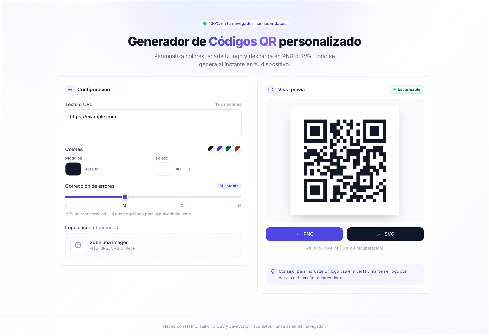

<div align="center">


<br /><br />

# Generador de Códigos QR Personalizado

**Crea códigos QR con tu identidad visual —colores, logo y nivel de corrección— y descárgalos en PNG o SVG. Todo ocurre en tu navegador: ningún dato se envía a un servidor.**

[**Ver demo en vivo**](https://lurdciano.github.io/QRgenerator/) · [Características](#-características) · [Cómo funciona](#-cómo-funciona) · [Empezar](#-empezar)

</div>

---

## 📖 Sobre el proyecto

La mayoría de los generadores de QR online son cajas negras: subes tu enlace a un servidor ajeno, te obligan a registrarte o te entregan una imagen con marca de agua. Este proyecto nace como alternativa: **una herramienta de una sola página, sin backend, sin cuentas y sin rastreo**, que además te avisa cuando una combinación de colores o un logo puede impedir que el código se escanee.

Es un proyecto de front-end puro que resolví con un único archivo `index.html`, priorizando el rendimiento, la accesibilidad y la calidad del resultado final (exportaciones nítidas, vectoriales y con zona de silencio correcta).

---

## ✨ Características

| | Característica | Detalle |
|---|---|---|
| 🎨 | **Personalización total** | Colores independientes para módulos y fondo, con 4 temas rápidos (Clásico, Índigo, Bosque, Atardecer). |
| 🖼️ | **Logo integrado** | Sube PNG, JPG, SVG o WebP (hasta 4 MB) o arrástralo directamente. Se centra y conserva su relación de aspecto. |
| 📐 | **Tamaño de logo controlado** | Slider de 8 % a 40 %, con el máximo recomendado según el nivel de corrección elegido. |
| 🛡️ | **Niveles L / M / Q / H** | Selección de tolerancia a errores con explicación clara de cuánto recupera cada nivel. |
| ✅ | **Validación de contraste** | Calcula el contraste WCAG entre módulos y fondo y advierte si baja de 3:1, el umbral de legibilidad. |
| 📥 | **Exportación PNG** | Imagen raster nítida (16 px por módulo), ideal para pantalla y redes sociales. |
| 🧩 | **Exportación SVG** | Vectorial y editable, con los módulos agrupados para reducir el peso del archivo. |
| 🔒 | **Privacidad por diseño** | Sin backend, sin cookies, sin analytics. El texto y las imágenes nunca salen del dispositivo. |
| 📱 | **Responsive** | Diseño de dos columnas en escritorio y una sola columna en móvil, con vista previa fija al hacer scroll. |
| ♿ | **Accesible** | Navegación por teclado, etiquetas ARIA y estados anunciados con `aria-live`. |
| ⚡ | **Rendimiento** | Render con *debounce* de 120 ms para no repintar en cada tecla. Sin dependencias de build. |

---

## 🔗 Demo

> **https://lurdciano.github.io/QRgenerator/**

No requiere instalación: se ejecuta directamente en el navegador.

<p align="center">
  
  <br />
  <sub>Interfaz del generador: personalización en tiempo real y validación de legibilidad.</sub>
</p>

---

## 🧠 Cómo funciona

El flujo completo vive en el navegador y se puede resumir en cuatro pasos:

```text
Texto / URL
    │
    ▼
qrcode-generator  ──►  matriz de módulos (según nivel L/M/Q/H)
    │
    ▼
Render en <canvas>  ──►  vista previa + PNG
    │
    └──►  Generación de SVG  ──►  descarga vectorial
```

**Decisiones técnicas destacadas:**

- **Un solo archivo.** Toda la aplicación —estructura, estilos y lógica— está en `index.html`. No hay paso de compilación ni `node_modules`, lo que la hace trivial de desplegar y de auditar.
- **Render propio sobre Canvas.** En lugar de usar la imagen que entrega la librería, se dibuja módulo por módulo con una zona de silencio de 4 módulos y 16 px por módulo. Así se controlan colores, resolución y posición del logo con precisión.
- **SVG optimizado.** Los módulos oscuros se agrupan en ejecuciones horizontales (`<rect>` contiguos), lo que reduce considerablemente el tamaño del archivo frente a un rectángulo por módulo.
- **Placa de respaldo para el logo.** El logo se dibuja sobre un rectángulo redondeado del color de fondo, lo que mejora el contraste y evita que los módulos de atrás interfieran con la lectura.
- **Validación de legibilidad.** El contraste se calcula con la fórmula de luminancia relativa de WCAG 2.x, y el tamaño del logo se compara con el porcentaje máximo tolerado por cada nivel de corrección.

### Niveles de corrección de errores

| Nivel | Recuperación | Logo recomendado | Cuándo usarlo |
|:---:|:---:|:---:|---|
| **L** | ~7 % | ≤ 10 % | QR limpios, sin logo, con mucho contenido. |
| **M** | ~15 % | ≤ 18 % | Equilibrio general para la mayoría de los casos. |
| **Q** | ~25 % | ≤ 25 % | Recomendado cuando se agrega un logo. |
| **H** | ~30 % | ≤ 30 % | Máxima tolerancia: logos grandes o superficies con desgaste. |

---

## 🛠️ Stack tecnológico

| Tecnología | Uso en el proyecto |
|---|---|
| **HTML5** | Estructura semántica y accesible. |
| **Tailwind CSS 3** (CDN) | Sistema de diseño, layout responsive y estados de la interfaz. |
| **JavaScript (ES5+)** | Lógica de generación, render en Canvas, exportación y validación. |
| **Canvas API** | Dibujo del QR en alta resolución y exportación a PNG. |
| **qrcode-generator 1.4.4** (CDN) | Codificación de la matriz QR con soporte UTF-8. |
| **Inter** (Google Fonts) | Tipografía de la interfaz. |

---

## 📂 Estructura del proyecto

```text
QRgenerator/
├── index.html        # Aplicación completa: marcado, estilos y lógica
├── docs/
│   └── preview.png   # Captura de la interfaz usada en este README
├── .gitignore
├── LICENSE
└── README.md
```

---

## 🚀 Empezar

### Opción 1 — Abrir directamente

```bash
git clone https://github.com/Lurdciano/QRgenerator.git
cd QRgenerator
```

Luego abre `index.html` en tu navegador. Listo.

### Opción 2 — Servidor local (recomendado)

Un servidor local evita restricciones del navegador al trabajar con archivos:

```bash
# Python 3
python -m http.server 8000

# o con Node.js
npx serve .
```

Visita `http://localhost:8000`.

> **Requisito:** conexión a internet para cargar Tailwind, la tipografía y la librería QR desde sus CDN. Si la librería no carga, la app lo detecta y muestra un mensaje claro en lugar de fallar en silencio.

---

## 📝 Guía de uso

1. **Escribe el contenido.** Un texto, una URL, datos de contacto o una configuración Wi-Fi.
2. **Elige los colores.** Usa los temas rápidos o define los colores de módulos y fondo. La app evalúa el contraste en tiempo real.
3. **Ajusta la corrección de errores.** Sube a **H** si vas a incorporar un logo.
4. **Agrega tu logo (opcional).** Haz clic en la zona de carga o arrastra una imagen; luego regula su tamaño.
5. **Revisa el indicador de estado.** Debe decir **«Escaneable»**. Si aparece una advertencia, el panel explica cómo corregirla.
6. **Descarga.** Elige **PNG** para uso general o **SVG** si necesitas escalar sin pérdida.

> 💡 **Consejo:** antes de imprimir, escanea el QR con dos o tres teléfonos distintos. La pantalla no siempre anticipa cómo se comporta la tinta sobre el papel.

---

## 🔐 Privacidad

Este proyecto no tiene servidor. En concreto:

- No se envía el texto, la URL ni el logo a ningún servicio.
- No se usan cookies, `localStorage` ni analítica.
- No hay cuentas, registro ni límites de generación.
- Las únicas peticiones externas son las de los CDN que sirven la librería, la tipografía y Tailwind.

---

## ♿ Accesibilidad

- Controles operables con teclado (incluida la zona de carga, con `Enter` y `Espacio`).
- Etiquetas descriptivas y `aria-label` en los controles personalizados.
- Estado del QR anunciado mediante `role="status"` y `aria-live="polite"`.
- El mensaje de estado combina color **y** texto: no depende solo del color.
- Jerarquía de encabezados y contraste de texto revisados.

---

## 🌐 Compatibilidad

Funciona en las versiones actuales de Chrome, Edge, Firefox y Safari, tanto en escritorio como en móvil. Usa `roundRect` con *fallback* manual para navegadores más antiguos.

---

## 🗺️ Roadmap

- [ ] Empaquetar las dependencias localmente para funcionar sin conexión.
- [ ] Modo oscuro con persistencia de la preferencia.
- [ ] Estilos de módulos (redondeados, con puntos) manteniendo la legibilidad.
- [ ] Plantillas de contenido: Wi-Fi, vCard, email, SMS y eventos de calendario.
- [ ] Historial local de los últimos diseños.
- [ ] Exportación a PDF en tamaño A4 y etiquetas.
- [ ] Pruebas automatizadas de la lógica de render y del cálculo de contraste.
- [ ] PWA instalable.

---

## 🤝 Contribuir

Las contribuciones son bienvenidas. Si encuentras un error o tienes una idea:

1. Abre un *issue* describiendo el caso y, si es posible, cómo reproducirlo.
2. Haz un *fork* del repositorio.
3. Crea una rama descriptiva: `git checkout -b feature/mi-mejora`.
4. Envía un *pull request* explicando el cambio y su motivación.

Para cambios visuales, incluye una captura antes/después. El código sigue el estilo ya presente en `index.html`: comentarios en español, funciones pequeñas y sin dependencias nuevas innecesarias.

---

## 📄 Licencia

Distribuido bajo la licencia **MIT**. Puedes usar, modificar y compartir el proyecto citando la autoría. Consulta el archivo [LICENSE](LICENSE) para el texto completo.

---

## 👤 Autor

**Luciano Ruiz Diaz** — Desarrollador

[](https://github.com/Lurdciano)
[](https://www.linkedin.com/in/luciano-ruizdiaz)
[](mailto:lurdciano@gmail.com)

<div align="center">

<sub>Hecho con HTML, Tailwind CSS y JavaScript. Tus datos nunca salen del navegador.</sub>

</div>
